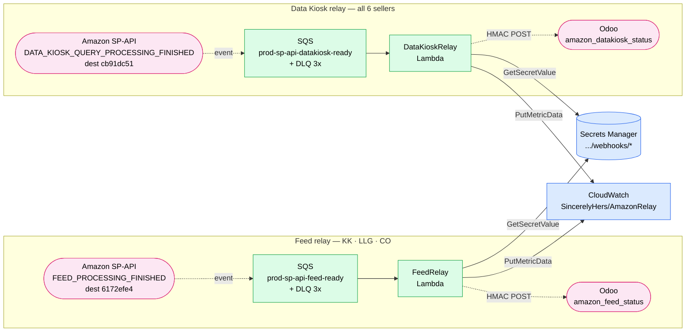
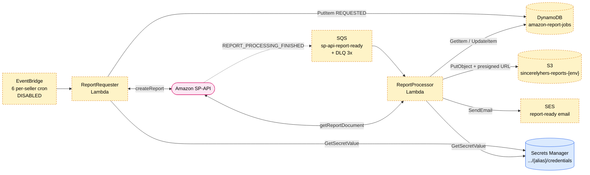
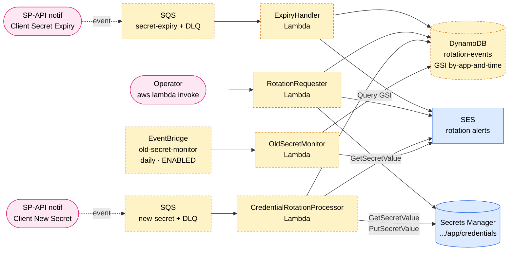
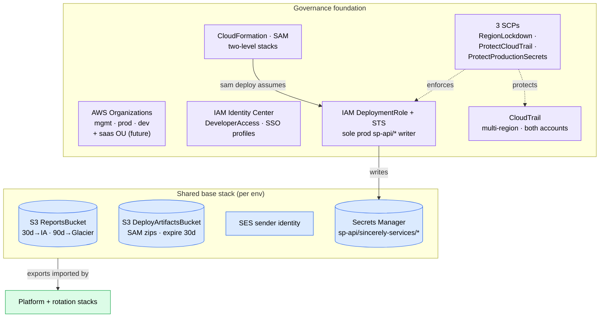
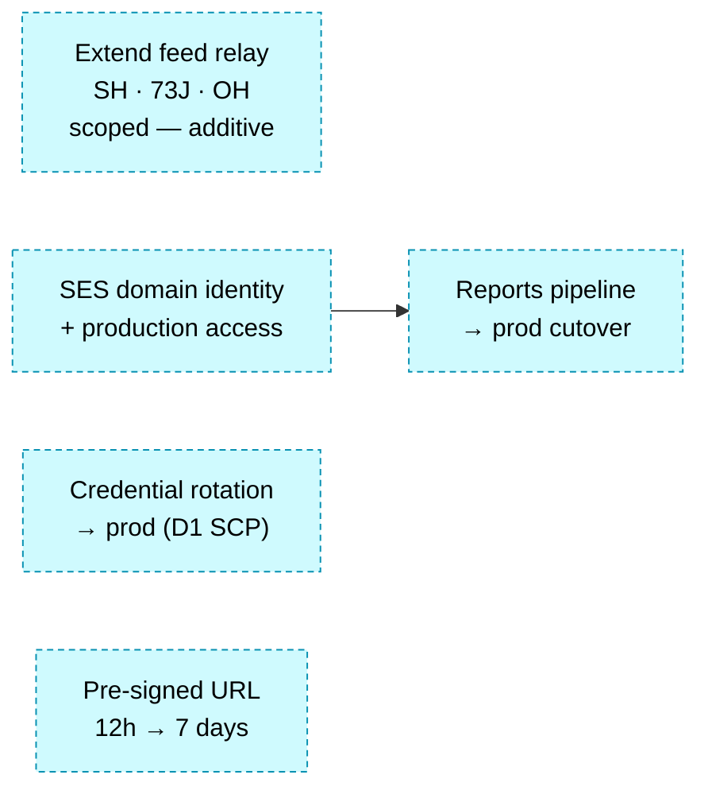

# System state map

A single-page picture of **what's deployed where** across the whole monorepo: the five event-driven pipelines, the shared base stack, the governance foundation, and the pending roadmap. Where the other pages zoom into one slice, this one is the wide shot — read it to orient, then follow the links into [02-amazon-runtime.md](02-amazon-runtime.md), [03-iac-topology.md](03-iac-topology.md), or [04-secrets-and-auth.md](04-secrets-and-auth.md) for depth.

Authoritative sources: [infrastructure/base-stack.yaml](../../infrastructure/base-stack.yaml), [platforms/amazon/template.yaml](../../platforms/amazon/template.yaml), [platforms/amazon/rotation-template.yaml](../../platforms/amazon/rotation-template.yaml), [infrastructure/org-setup/](../../infrastructure/org-setup/). Applied IDs and status live in [infrastructure/org-setup/README.md](../../infrastructure/org-setup/README.md) — not here.

## How to read the colors

Unlike the other pages (which color by service type), this map's job is deployment status, so **fill color = state** and **node shape = kind** (cylinder = datastore/queue, stadium = external-to-AWS, rectangle = compute/rule):

| Color | Meaning |
|---|---|
| 🟩 green | Live in production |
| 🟧 amber (dashed) | Dev only / disabled — not cut over to prod |
| 🟦 blue | Shared base stack (per-env) |
| 🟪 violet | Governance foundation |
| 🟦 teal (dashed) | Pending / roadmap |
| 🟥 pink (stadium) | External to AWS |

## Platform stack — notification relays

Two structurally identical relays, both **live in prod**. Each SP-API notification lands on a per-type SQS queue (own DLQ, 3× redrive), a Lambda reads the per-seller webhook secret and HMAC-signs an HTTPS POST to Odoo, and emits a CloudWatch metric. They differ only in the dispatch key: the feed relay keys on `sellerId`, Data Kiosk on the full `accountId`.

## Platform stack — reports pipeline

**Deployed to prod but dev-only in practice** — the six per-seller EventBridge rules ship `DISABLED` and no prod `REPORT_PROCESSING_FINISHED` subscriptions exist, so this round-trip runs only in dev. Full time-ordered behavior (including the idempotent skip on externally-requested reportIds) is in [02-amazon-runtime.md](02-amazon-runtime.md).

## Credential rotation stack

A per-app stack ([rotation-template.yaml](../../platforms/amazon/rotation-template.yaml)), deployed in **dev** for the `services` and `bobnathan` apps, running as policy C (**alert-only** — no auto-rotate). Two SP-API app-management notifications feed two queues; a daily monitor watches for expiring old secrets; the operator triggers an actual rotation by hand. Design history in [docs/design/credential-rotation.md](../design/credential-rotation.md).

## Shared base + governance foundation

The base stack ([base-stack.yaml](../../infrastructure/base-stack.yaml)) is deployed once per environment; platform and rotation stacks import its exports via `Fn::ImportValue`. Underneath sits the governance layer — applied out-of-band from the management account; this repo only stores the policy source. Deep-dives: [03-iac-topology.md](03-iac-topology.md) and [01-organizations.md](01-organizations.md).

## Pending & roadmap

Open TODOs, ordered by readiness. The one real dependency: SES must move off the sandbox before the reports feature can go to prod.

| Item | Status | Gate / blocker |
|---|---|---|
| **Extend feed relay to SH · 73J · OH** | Scoped, not started (2026-07-08) | Purely additive — no re-point, no new credentials, reuses feed dest `6172efe4`. Gated on confirming Odoo `amazon_feed_status` tolerates all feed types (`FEED_PROCESSING_FINISHED` can't be filtered by type). |
| **Reports pipeline → prod cutover** | Planned | Enable the 6 `DISABLED` rules + create prod subs. Hits the re-point wall — dev holds all six `REPORT_PROCESSING_FINISHED` subs (one per seller × type), so each is a `delete` then `create`, stopping dev delivery. |
| **SES domain identity + production access** | Prerequisite | Blocks the reports cutover — sandbox mode requires every recipient be individually verified. Move to a domain identity and request production access first. |
| **Credential rotation → prod** | Gated · SCP | Needs the D1 carve-out amending `ProtectProductionSecrets` so `CredentialRotationProcessorRole` can `PutSecretValue` on `app/credentials`, applied from the management account. |
| **Pre-signed URL 12h → 7 days** | Backlog | Needs CloudFront signed URLs (or long-lived IAM creds, which the access model disallows) — not achievable from a Lambda execution role alone. |

## What's NOT here

- **Runtime sequence** of the reports round-trip — see [02-amazon-runtime.md](02-amazon-runtime.md).
- **Deploy-time flow** and DeploymentRole mechanics — see [03-iac-topology.md](03-iac-topology.md).
- **Secret layout and LWA token exchange** — see [04-secrets-and-auth.md](04-secrets-and-auth.md).
- **SCP semantics and account tree** — see [01-organizations.md](01-organizations.md).
